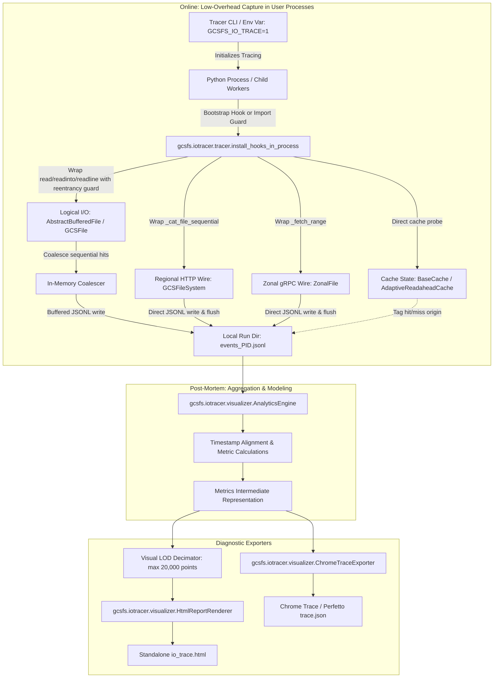

# Zero-Code GCSFS Multi-Process I/O Pattern Tracer and Visualizer

*   **Author:** Prince Kumar
*   **Status:** Draft
*   **Date:** 2026-11-03

--------------------------------------------------------------------------------

## Overview

Modern deep learning training, model evaluation, and distributed data analytics workloads frequently encounter severe storage I/O bottlenecks. In frameworks such as PyTorch, Hugging Face `datasets`, TorchData, and Ray Data, GPU compute units often sit idle during training steps while worker processes wait on remote object reads. When these frameworks read data from Google Cloud Storage via `gcsfs`, identifying the root cause of slow data ingestion is exceptionally difficult.

This design introduces a zero-code-change diagnostic subsystem packaged as an integrated submodule inside the `gcsfs` distribution under the dedicated namespace `gcsfs.iotracer` (CLI: `gcsfs-iotrace`). This dedicated namespace prevents naming collisions with any future general-purpose OpenTelemetry or client-side RPC tracing additions to `gcsfs`. Users can profile any Python workload running on a single node using three invocation mechanisms:
1.  **CLI Runner**: Executing `gcsfs-iotrace run <script.py> [args...]` or `python -m gcsfs.iotracer <script.py> [args...]`.
2.  **Environment Variable**: Setting `export GCSFS_IO_TRACE=1` (or `GCSFS_IO_TRACE_DIR=/path/to/traces`) before running standard `python <script.py>`. When `gcsfs` is imported, the root process creates a dedicated trace run directory, exports `GCSFS_IO_TRACE_DIR` so spawned child processes converge on the same path, and installs in-process interception hooks.
3.  **Programmatic Context Manager**: Wrapping targeted execution blocks directly within application or benchmark code via `with gcsfs.iotracer.trace_io(output_html="trace.html"): ...`.

The tracer simultaneously captures two distinct layers of I/O activity:
1.  **Logical I/O**: The file read requests submitted by the application (`fsspec.spec.AbstractBufferedFile.read`, `readinto`, `readline`, `GCSFileSystem.cat_file`, and cache block hits/misses).
2.  **Physical Wire I/O**: The underlying network data transfers dispatched to Cloud Storage (HTTP range requests via `aiohttp` for regional/multi-regional buckets, and multi-range gRPC downloads for Zonal buckets).

To prevent event logging from becoming an I/O bottleneck on high-throughput workloads, each worker process writes line-delimited JSON (JSONL) records using 64 KiB buffered I/O, combined with in-memory contiguous cache-hit coalescing (merging rapid sequential reads on the same file and thread into single representative spans) and periodic auto-flushing on wire transfers and file closures to ensure trace durability against abrupt worker termination (`os._exit(0)`). Tracing enforces a configurable session cap (default: 500,000 events or 100 MiB per worker) to guarantee lightweight post-processing. Upon workload completion, the trace files are processed into two diagnostic artifacts:
*   A standalone interactive HTML dashboard presenting summary Key Performance Indicators (KPIs), request size distributions, latency percentiles, storage concurrency curves, and level-of-detail (LOD) decimated space-time access locality scatter plots.
*   A standard Chrome Trace Event JSON file (`trace.json`) that can be loaded directly into [ui.perfetto.dev](https://ui.perfetto.dev) or `chrome://tracing` for microsecond-level timeline zooming and multi-process thread correlation.

--------------------------------------------------------------------------------

## Problem Statement

Today, storage and machine learning engineers have no straightforward mechanism to observe how `gcsfs` satisfies application read requests. Current diagnostic practices suffer from severe structural shortcomings:

1.  **The `gcsfuse` Observability Disconnect**:
    Developers often mount Cloud Storage buckets via `gcsfuse` to capture access patterns using filesystem monitoring tools. However, `gcsfuse` routes requests through the Linux VFS kernel layer, altering the data path and completely obscuring `gcsfs` userspace mechanisms such as `block_size` buffering, asynchronous prefetching (`AdaptiveReadaheadCache`), and client-side memory caching.

2.  **Invasive Code Modifications**:
    Profiling `gcsfs` directly today requires modifying application code to inject custom wrappers, profilers, or callback shims. In third-party libraries (Hugging Face Datasets, PyTorch DataLoader workers, Ray Data), `GCSFileSystem` is instantiated deep within library code, making manual instrumentation impractical without maintaining custom forks.

3.  **Unstructured Text Debug Logs (`logging.DEBUG`)**:
    Developers frequently enable verbose text debugging (`logging.getLogger("gcsfs").setLevel(logging.DEBUG)`) and attempt to parse the resulting gigabytes of log output manually. This approach fails because:
    *   Unstructured text logs incur severe disk I/O serialization overhead on performance-critical loops.
    *   Text logs lack structured nanosecond timestamps, byte ranges, and thread identifiers required to accurately compute read amplification ratios or latency percentiles.
    *   Text logs cannot visually represent concurrency over time or space-time access locality.

4.  **Multi-Process Trace Truncation (`os._exit`) vs. Hot-Path Event Storms**:
    In PyTorch, `DataLoader(num_workers > 0)` terminates worker processes using `os._exit(0)`. Standard Python exit hooks (`atexit`) and user-space stream buffers (`io.BufferedWriter`) are bypassed. Furthermore, workloads performing thousands of tiny sequential reads can flood disk logging if each read emits a separate record. A balanced mechanism must use in-memory contiguous read coalescing paired with low-overhead buffered writing and frequent wire-triggered flushes so that tail events survive child worker termination.

5.  **Async Threading and gRPC Blindspots**:
    `gcsfs` performs network I/O on a background event-loop thread (`self.loop`), decoupled from the caller's thread. Existing diagnostic prototypes that use thread-local counters misattribute cache hits and fail to track asynchronous prefetch blocks. Furthermore, existing HTTP-focused logging completely ignores gRPC transfers on Cloud Storage Zonal buckets.

--------------------------------------------------------------------------------

## Goals

*   **Zero-Code Invocation**: Enable full I/O tracing without modifying user source code, supporting CLI execution (`python -m gcsfs.iotracer script.py [args...]` or `gcsfs-iotrace run script.py`) and environment-variable activation (`GCSFS_IO_TRACE=1` or `GCSFS_IO_TRACE_DIR=/path`).
*   **Collision-Safe Submodule Packaging**: Package the tracer directly within `gcsfs` under `gcsfs.iotracer` / `gcsfs.cli.iotracer` (CLI: `gcsfs-iotrace`), ensuring automated verification in CI while preserving the `gcsfs.trace` namespace for future OpenTelemetry or RPC tracing.
*   **Dual-Layer Observability**: Simultaneously capture application-level logical reads (`fsspec.spec.AbstractBufferedFile.read`, `readinto`, `readline`, cache hits, `cat_file`) and backend storage requests (HTTP GET range requests via `_cat_file_sequential` and Zonal gRPC multi-range fetches via `ZonalFile._fetch_range`), tagged with Process ID (`PID`) and Thread ID (`TID`).
*   **In-Memory Coalescing & Buffered JSONL**: Minimize logging overhead by coalescing contiguous sequential reads in memory and writing line-delimited JSON with 64 KiB buffer chunks and wire-event auto-flushing, keeping logging overhead under 1 µs on hot paths while remaining directly inspectable with standard Unix tools (`jq`, `grep`).
*   **Configurable Session Capping**: Enforce a default ceiling of 500,000 events or 100 MiB per worker process (configurable via `--max-events` and `--max-size-mb`) to prevent disk exhaustion and ensure fast offline post-processing.
*   **Quantitative KPI Synthesis**: Automatically calculate and report:
    *   **Read Amplification Factor ($\text{RAF}$)**: Ratio of total bytes fetched from storage to logical bytes consumed by the application ($\text{RAF} = \text{Bytes}_{\text{wire}} / \text{Bytes}_{\text{logical}}$).
    *   **Request Size Distributions**: Histograms and percentiles ($p_{50}, p_{90}, p_{99}$) for both logical reads and wire transfers.
    *   **Latency Percentiles**: Distribution of backend storage response times and async queue waiting times.
    *   **Storage Concurrency Profiles**: Active concurrent requests and instantaneous throughput over elapsed time.
    *   **Cache Efficiency**: Block cache and prefetcher hit rates, distinguishing between useful prefetches and discarded prefetch data.
*   **Dual Diagnostic Artifacts**:
    1.  A standalone, single-file HTML report containing interactive space-time locality scatter plots with Level-of-Detail (LOD) downsampling, per-PID Gantt charts, and summary metric cards with zero external CDN dependencies (reusing and hardening the existing internal performance test prototype in `gcsfs/tests/perf/_common/io_vis/io_tracer.py`).
    2.  A standard Chrome Trace Event JSON export (`trace.json`) loadable directly into [ui.perfetto.dev](https://ui.perfetto.dev) or `chrome://tracing` for microsecond-level timeline zooming and offline flow correlation.
*   **Crash-Resilient Post-Mortem Tooling**: Provide an explicit offline report generation command (`gcsfs-iotrace report <trace_dir>`) capable of parsing partial trace logs if a workload terminates abnormally.

--------------------------------------------------------------------------------

## Non-Goals

*   **Multi-Node Distributed Consensus**: Distributed network collectors, cross-node log aggregation daemons, and cluster-wide clock synchronization are out of scope. Tracing is strictly scoped to a single node.
*   **Live In-Flight Dashboard**: No real-time web servers or streaming telemetry sockets that consume host CPU or network bandwidth during training execution.
*   **Native C++ Engine Detection/Interception**: Calls from native C++ engines (such as PyArrow C++ GCS client, DuckDB native GCS, or TensorFlow C++ I/O) that bypass Python `gcsfs` are not intercepted. Tracing records Python-level PID and TID events directly without attempting to introspect external C++ runtimes.
*   **Runtime Auto-Tuning**: The tool is strictly diagnostic and will not dynamically mutate `gcsfs` block sizes, cache policies, or retry parameters during workload execution.
*   **Deep Write Buffer Profiling**: Comprehensive write-pipeline profiling (e.g. multipart upload part management) is excluded; primary architectural focus is read optimization.

--------------------------------------------------------------------------------

## Resolved Design Decisions

*   **Namespace Isolation (`iotracer`)**: Renamed from generic `tracer` to `iotracer` (`gcsfs.iotracer` and `gcsfs-iotrace`) to guarantee zero naming collisions if standard OpenTelemetry or RPC tracing is introduced into `gcsfs` in the future.
*   **JSONL with Coalescing over Binary Protobuf**: Replaced binary serialization with line-delimited JSON (JSONL) buffered at 64 KiB, leveraging sequential cache-hit coalescing. This eliminates custom binary deserializers and schema migrations while preserving human readability and command-line inspectability (`jq`, `head`).
*   **Unified Visualizer Architecture**: Maintained the self-contained HTML5 Canvas visualizer from the internal prototype (`gcsfs/tests/perf/_common/io_vis/io_tracer.py`) with visual Level-of-Detail (LOD) downsampling, pairing it with standard Chrome Trace Event JSON for deep multi-process timeline drilldowns in Perfetto, dropping the speculative 2D density heatmap canvas engine.
*   **Configurable Session Cap**: Configured a default ceiling of 500,000 events or 100 MiB per worker (`--max-events 500000`, `--max-size-mb 100`), ensuring rapid post-processing and responsive browser rendering.
*   **Consolidated 3-Module Footprint**: Consolidated implementation into 3 cohesive modules (`tracer.py`, `visualizer.py`, and `cli/iotracer.py`), avoiding unnecessary package fragmentation.
*   **Offline Temporal Flow Correlation**: Rather than injecting artificial keyword arguments across private async APIs and mutating shared file instances, the offline normalizer correlates logical read misses to corresponding wire fetches by matching overlapping temporal windows and byte ranges during post-processing.

--------------------------------------------------------------------------------

## Critical User Journeys (CUJs)

### CUJ 1: Diagnosing PyTorch DataLoader Read Amplification
*   **Given**: A machine learning engineer is training a Vision Transformer on a sharded Parquet dataset using PyTorch `DataLoader(num_workers=8)` and experiencing GPU starvation.
*   **When**: The engineer prefixes their training launch command with `gcsfs-iotrace run python train.py --epochs 1 --batch-size 64`.
*   **Then**: The training runs without code changes. Upon epoch completion, the CLI prints a path to `io_trace.html`. The engineer opens the file in a browser, observes a summary KPI card showing a Read Amplification Factor of $14.2\times$, and views the space-time scatter plot showing that workers are opening files repeatedly to read tiny Parquet footers without caching.

### CUJ 2: Tuning `block_size` and Cache Configuration
*   **Given**: A data engineer wants to determine whether `cache_type="adaptive"` or `cache_type="readahead_chunked"` with a 4 MiB block size provides higher throughput and lower read amplification for a streaming training dataset.
*   **When**: The engineer executes two consecutive benchmark runs wrapped in `gcsfs-iotrace run --output trace_run1.html python benchmark.py` and `gcsfs-iotrace run --output trace_run2.html python benchmark.py`.
*   **Then**: The engineer compares the two resulting HTML dashboards side-by-side. The dashboard clearly contrasts total wire bytes transferred, average request latency percentiles ($p_{50}, p_{99}$), and discarded prefetch data, enabling an evidence-based configuration decision.

### CUJ 3: Microsecond Wire Inspection in Perfetto
*   **Given**: A systems engineer wants to determine whether storage latency spikes on Cloud Storage Zonal buckets are caused by network transport delay or async event-loop queuing.
*   **When**: The engineer runs `gcsfs-iotrace run --export-trace train.py`, producing `trace.json`, and drops the file into `ui.perfetto.dev`.
*   **Then**: Perfetto renders hierarchical process and thread tracks showing individual `GCSFile.read` spans connected to the corresponding gRPC `AsyncMultiRangeDownloader` chunk slices, clearly separating enqueue latency from wire transfer time.

--------------------------------------------------------------------------------

## Technical Plan (Architecture)

### 1. High-Level Subsystem Architecture

The tracer subsystem is organized into three components spanning three stages: online event capture, analytical aggregation, and diagnostic export.



--------------------------------------------------------------------------------

### 2. Component Breakdown

#### A. Launcher & Process Lifecycle (`gcsfs.cli.iotracer`, `gcsfs.iotracer.tracer`)
*   **CLI Entry Points**: Exposes `gcsfs-iotrace` and `python -m gcsfs.iotracer`:
    *   `gcsfs-iotrace run [tracer-opts] <script.py> [script-opts...]`: Executes the user script, forwarding remaining arguments directly to the target script. (Note: `python -m gcsfs.iotracer <script.py>` defaults directly to the `run` action for CLI ergonomics).
    *   `gcsfs-iotrace report <trace-dir> [report-opts]`: Processes an existing trace directory post-mortem.
*   **Auto-Injection Mechanism (CLI Execution)**:
    *   The CLI runner checks available storage capacity on the target filesystem using `shutil.disk_usage`. It creates a private, isolated temporary run directory (default: `/tmp/gcsfs_iotrace_<pid>_<uuid>` with fallback to `./.gcsfs_traces` if `/tmp` is space-constrained or memory-backed).
    *   Creates a `_bootstrap/sitecustomize.py` script and prepends `_bootstrap` to `PYTHONPATH`.
    *   Sets `GCSFS_IO_TRACE=1` and `GCSFS_IO_TRACE_DIR=<run_dir>`.
    *   Ensures child processes spawned via `multiprocessing.set_start_method("spawn")`, `torch.multiprocessing`, or `subprocess.Popen` automatically execute `sitecustomize.py` and inherit tracing without code modification.
*   **Environment-Variable Invocation (`export GCSFS_IO_TRACE=1`)**:
    *   In environments where launching through the CLI wrapper is infeasible (e.g. managed training orchestrators or container runtimes executing `python train.py`), users can set `export GCSFS_IO_TRACE=1`.
    *   `gcsfs/__init__.py` inspects `os.getenv("GCSFS_IO_TRACE")` on module import. If enabled and `GCSFS_IO_TRACE_DIR` is not yet set, the parent process immediately creates a timestamped run directory and writes `os.environ["GCSFS_IO_TRACE_DIR"] = run_dir` before initializing hooks via `gcsfs.iotracer.tracer.install_hooks_in_process()`. All subsequent worker processes spawned via `multiprocessing` or `subprocess` inherit the same `GCSFS_IO_TRACE_DIR`, ensuring multi-process logs converge in a single directory.
    *   Registers an `atexit` hook in the root process to synthesize reports into `io_trace.html` upon workload completion.
*   **Programmatic Context Manager (`trace_io`)**:
    *   Users can profile specific code blocks directly in Python benchmark scripts or unit tests:
        ```python
        import gcsfs.iotracer

        with gcsfs.iotracer.trace_io(output_html="dataloader_trace.html"):
            for batch in dataloader:
                train_step(batch)
        ```
    *   `trace_io` sets up a dedicated temporary trace directory, installs interception hooks for the duration of the `with` block, flushes per-PID event buffers on exit, aggregates trace logs, and generates the requested HTML and JSON reports.

#### B. Runtime Interception & Coalesced Logging (`gcsfs.iotracer.tracer`)
The runtime module combines interception hooks with the buffered JSONL logger:

1.  **Logical Application Reads & Reentrancy Guards**:
    *   Targets: `AbstractBufferedFile.read`, `readinto`, `readline`, and `GCSFileSystem.cat_file`.
    *   Reentrancy Guard: In `fsspec`, compound operations (`readline`, `readinto`) delegate internally to `read()`. To eliminate event double-counting and metric corruption, the wrapper checks a thread-local flag (`_TLS.in_logical_read`). If already set, the nested invocation executes without emitting a second event.
    *   Metadata Captured: File path, seek offset, requested byte length, duration ($t_{\text{start}}, t_{\text{end}}$), process ID (`pid`), thread ID (`tid`), and cache hit state.
2.  **Sequential Cache-Hit Coalescing**:
    *   Workloads reading small sequential records (e.g. 50-byte record parsing) can generate millions of calls.
    *   If a thread issues a sequential read on the same file (`offset == prev_offset + prev_length`) within a 2 ms window and it is a cache hit, the logger updates the in-memory accumulator's `len` and `te` instead of writing a new JSON line. This reduces event volume by up to ~90% on tight sequential read loops.
3.  **Regional HTTP Range Requests**:
    *   Target: `GCSFileSystem._cat_file_sequential`.
    *   Rationale: In `gcsfs.core`, all physical HTTP data-path reads (direct reads, block cache fills, and background prefetch downloads) converge on `_cat_file_sequential`. Intercepting `_cat_file_sequential` cleanly isolates data transfers without wrapping lower-level `_request` (which would erroneously capture non-data control-plane RPCs like metadata queries, bucket listings, and ACL checks).
    *   Reentrancy Guard: When `GCSFile._fetch_range` delegates to `fs.cat_file` which calls `_cat_file_sequential`, depth tracking (`_TLS.in_fetch_range`) ensures that wire events are attributed to network transfer without duplicate wrapping.
    *   Metadata Captured: Byte range (`off`, `len`), wire duration, response headers (`req_id` from `x-goog-request-id`, `x-goog-generation`), HTTP status, and transport (`"http"`).
4.  **Zonal Bucket gRPC Range Requests**:
    *   Target: `gcsfs.zonal_file.ZonalFile._fetch_range`.
    *   Handling Chunk Lengths: When `chunk_lengths` is passed to `ZonalFile._fetch_range`, it returns `list[bytes]`. The hook accurately records transferred byte length as `sum(chunk_lengths)` (or total bytes received across chunks) and notes `transport="grpc"`.
5.  **Cache Accounting & Wire Attribution**:
    *   Logical read operations query whether bytes were served from local memory cache blocks. Operations are classified into `hit_state` (`"full"`, `"partial"`, or `"miss"`) with `cached_bytes` recorded.
    *   Wire fetches triggered directly by caller read misses are tagged with `wire_origin="direct_miss"`.
    *   Asynchronous background prefetches dispatched by the prefetch producer ahead of caller requests are tagged with `wire_origin="async_prefetch"`.
6.  **Fork Safety & `os._exit(0)` Durability**:
    *   `os.register_at_fork(after_in_child=...)` re-initializes process state, resets internal locks, and opens a dedicated `events_<pid>.jsonl` log file for the child process.
    *   **Durability Policy**: Files are opened with 64 KiB buffered I/O (`buffering=65536`). To ensure child logs survive sudden PyTorch worker termination (`os._exit(0)`), the logger enforces three explicit flush triggers:
        1.  *Wire Transfer Completion*: Any wire fetch event automatically flushes the process log file (`self._fp.flush()`), guaranteeing that network boundaries are committed to disk.
        2.  *File Closure*: Calling `close()` or object finalization on an active file handle invokes `_LOGGER.flush()`.
        3.  *Batch Threshold*: Logical reads flush every 1,000 coalesced records.
        This bounds potential event loss upon `os._exit(0)` strictly to uncoalesced in-memory cache-hit spans, ensuring zero wire events are lost.

#### C. Trace Event Schema (JSONL)
Each record is serialized as a compact, self-contained JSON line:

| Field | Type | Description |
| :--- | :--- | :--- |
| `t` | `float` | Relative elapsed seconds from trace baseline ($t_0$) using `time.monotonic()` |
| `dur` | `float` | Duration of the operation in seconds |
| `layer` | `str` | Layer category: `"logical"` or `"wire"` |
| `op` | `str` | Operation type: `"read"`, `"readline"`, `"readinto"`, `"cat_file"`, `"fetch_range"`, or `"prefetch"` |
| `path` | `str` | Normalized object path in GCS |
| `off` | `int` | Byte offset in file |
| `len` | `int` | Requested or transferred byte length |
| `pid` | `int` | Operating system Process ID |
| `tid` | `int` | Operating system Thread ID |
| `hit_state` | `str` | Cache status: `"full"`, `"partial"`, or `"miss"` |
| `cached_len`| `int` | Bytes served directly from memory cache blocks |
| `wire_origin`| `str` | Wire origin: `"direct_miss"` or `"async_prefetch"` (wire events only) |
| `transport` | `str` | Network transport: `"http"` or `"grpc"` (wire events only) |
| `req_id` | `str` | Optional GCS `x-goog-request-id` header for HTTP wire calls |

When a worker reaches `--max-events` or `--max-size-mb`, the logger writes a terminal sentinel record (`{"op": "trace_truncated", "reason": "max_events", "pid": pid}`) before halting logging to ensure offline analytics clearly display a truncation warning.

#### D. Visualizer & Exporters (`gcsfs.iotracer.visualizer`)
The visualizer module aggregates raw JSONL files and generates diagnostic artifacts:
1.  **Analytics Normalization**: Ingests all `events_*.jsonl` files in the run directory, aligns timestamps, and calculates:
    *   $\text{RAF} = \sum \text{Length}_{\text{wire}} / \sum \text{Length}_{\text{logical}}$.
    *   Latency percentiles ($p_{50}, p_{90}, p_{99}$) for logical reads and wire transfers.
    *   Concurrency profiles: Active concurrent requests per millisecond time slice.
    *   Cache waste: Prefetched bytes discarded unread.
2.  **Standalone HTML Dashboard with Visual LOD Decimation**:
    *   Reuses and hardens the self-contained HTML5 Canvas visualizer from the existing internal performance test prototype in `gcsfs/tests/perf/_common/io_vis/io_tracer.py`.
    *   **Visual LOD Decimator**: To prevent browser tab freezes when rendering runs with hundreds of thousands of events, `AnalyticsEngine` applies a spatial decimation step for the scatter plot, bucketing dense contiguous points into representative visual bounds (maximum 20,000 data points rendered on Canvas).
    *   Zero external dependencies (embedded CSS/JS).
    *   Interactive space-time scatter plot (byte offset vs. elapsed time) with zoom/pan, per-PID Gantt timeline, throughput curves, and summary KPI cards.
3.  **Chrome Trace Event Exporter**:
    *   Emits standard Chrome Trace Event JSON (`trace.json`) compatible with [ui.perfetto.dev](https://ui.perfetto.dev) and `chrome://tracing` containing the complete, un-decimated microsecond event history.
    *   Organizes tracks by PID and TID, linking logical read slices to corresponding wire transfers via post-mortem temporal interval matching.

--------------------------------------------------------------------------------

## Alternatives Considered

### Alternative 1: Standalone External Package (`gcsfs-tracer` / `fsspec-tracer`)
*   **Pros**: Keeps the `gcsfs` core distribution lean; enables an independent release cadence for visualization enhancements.
*   **Cons**: Requires maintaining a separate repository, separate CI matrix, and PyPI release credentials. High risk of silent breakage whenever `gcsfs` refactors internal private methods (`_cat_file_sequential`, `_async_fetch_range`, `ZonalFile._fetch_range`) because no CI in the core repo would flag regressions. Adds installation friction for users who already have `gcsfs` installed.
*   **Reason for Rejection**: Packaging the tracer as an internal submodule inside `gcsfs` ensures automated verification in `gcsfs` pull request CI and eliminates cross-package version drift and installation hurdles.

### Alternative 2: Custom 48-Byte Binary Serialization Protocol
*   **Pros**: Highly compact on-disk representation.
*   **Cons**: Introduces premature complexity (struct packing, string interning tables, schema versioning, endianness handling, and custom deserializers). Prevents standard Unix inspection (`jq`, `grep`, `head`). Unnecessary because 64 KiB buffered JSONL paired with in-memory sequential read coalescing keeps logging overhead negligible (<1 µs).
*   **Reason for Rejection**: Line-delimited JSON with sequential read coalescing provides equal performance with superior debuggability and simplicity.

### Alternative 3: Unstructured Text Logging (`logging.DEBUG`)
*   **Pros**: Built into Python standard library; zero extra code.
*   **Cons**: Incurs severe disk I/O overhead on performance-critical loops; exposes sensitive authentication headers; lacks structured temporal alignment between logical caller operations and asynchronous background prefetch routines; lacks byte-range concurrency and access locality schemas.
*   **Reason for Rejection**: Unstructured text logs lack the nanosecond temporal alignment, thread correlation, and byte-range metadata necessary to compute deterministic I/O metrics or visualize space-time locality.

### Alternative 4: Standard OpenTelemetry (OTel) Python SDK for In-Flight Capture
*   **Pros**: Vendor-neutral standard; existing collector and UI ecosystem.
*   **Cons**: Heavy dependency footprint; per-span object allocation creates significant garbage collection pauses in high-frequency read loops; span batch processors can drop spans upon sudden worker `os._exit(0)`.
*   **Reason for Rejection**: High object allocation overhead and GC pauses in tight read loops make OTel unsuitable for high-frequency in-flight capture; retained only as a potential offline export format.

### Alternative 5: Kernel-Level eBPF / `bpftrace` / `strace`
*   **Pros**: Zero Python interpreter wrapping; completely transparent to application code.
*   **Cons**: Requires root or `CAP_SYS_ADMIN` privileges (incompatible with standard unprivileged container platforms like GKE or Vertex AI); cannot inspect TLS-encrypted Cloud Storage headers without complex uprobes; lacks visibility into `fsspec` caching and logical read boundaries.
*   **Reason for Rejection**: Incompatible with unprivileged container environments and fundamentally blind to Python-level `fsspec` caching and logical read boundaries.

### Alternative 6: Explicit Callback API (`GCSFileSystem(callbacks=[...])`)
*   **Pros**: Avoids monkey-patching; decoupled from internal method refactoring.
*   **Cons**: Violates the zero-code-change requirement; third-party frameworks (TorchData, Hugging Face, Ray) instantiate `gcsfs` internally and do not expose callback injection hooks.
*   **Reason for Rejection**: Fails to support third-party libraries (Hugging Face Datasets, PyTorch DataLoader) that instantiate `gcsfs` internally without exposing callback parameters.

--------------------------------------------------------------------------------

## Risks & Mitigations

### 1. Container `tmpfs` Memory Exhaustion
*   **Risk**: In container environments (Kubernetes, GKE, Vertex AI), `/tmp` is frequently backed by a size-constrained memory mount (`tmpfs`). A large multi-worker training workload generating multiple 100 MiB logs can exhaust container RAM and trigger cgroup OOM-kills of the training job.
*   **Mitigation**: Before initializing file sinks, the tracer checks target mount headroom via `shutil.disk_usage`. If free space is below 2 GiB or `/tmp` is detected as a `tmpfs` mount, the tracer emits an explicit warning log recommending setting `GCSFS_IO_TRACE_DIR` to a persistent scratch volume, and enforces the default 100 MiB per-worker file cap.

### 2. Upstream Internal Refactoring & Monkeypatch Fragility
*   **Risk**: Future updates to `gcsfs` or `fsspec` could rename or refactor internal private methods (`_cat_file_sequential`, `_fetch_range`), leading to silent trace bypasses or runtime `AttributeError` exceptions.
*   **Mitigation**: Packaging the subsystem directly in the `gcsfs` repository ensures that all monkey-patching shims are exercised in the core repository's Continuous Integration (CI) test suite. If an internal method is renamed, CI tests fail immediately before release. Furthermore, all monkey-patch hooks are wrapped in safety guards that catch unexpected exceptions and log warnings rather than crashing user training scripts.

### 3. Asynchronous Loop & Concurrency Deadlocks
*   **Risk**: `gcsfs` executes network I/O across an asynchronous event-loop bridge (`self.loop`). Tracing hooks executing synchronous logging on the event-loop thread could introduce lock contention or deadlocks.
*   **Mitigation**: `_ProcessEventLogger` uses lock-free process isolation (`events_<pid>.jsonl`), process-local reentrancy guards, and lightweight file appends. Event logging never schedules blocking tasks back onto the asyncio event loop.

### 4. Browser Freeze on Large Trace Reports
*   **Risk**: Loading millions of raw event records into an HTML document can consume hundreds of megabytes of RAM and crash browser tabs.
*   **Mitigation**: The HTML report generator applies Level-of-Detail (LOD) spatial decimation, bucketing dense contiguous records into a maximum of 20,000 visual scatter intervals. Full microsecond resolution without decimation is offloaded to the streaming Chrome Trace JSON export (`trace.json`) designed for [ui.perfetto.dev](https://ui.perfetto.dev).

--------------------------------------------------------------------------------

## Non-Functional Requirements

### 1. Performance & Overhead
*   **In-Flight Latency Overhead**: The hot-path interception shim (coalescing check and buffered JSON append) executes in $< 1.0\ \mu\text{s}$. Target SLA: $< 2\%$ overall runtime degradation for read-intensive workloads.
*   **Memory Footprint**: Process-local buffer memory is strictly capped at $\le 2\text{ MiB}$ per worker to minimize OOM risk.
*   **Disk Bandwidth & Quota**: Log writes use 64 KiB buffered chunks. Total trace volume is capped by the configurable default ceiling of 500,000 events or 100 MiB per worker.

### 2. Reliability & Fault-Tolerance
*   **Worker Survival (`os._exit`)**: Wire-triggered flushes, file `close()` flushes, and batch threshold flushes minimize tail record loss upon sudden process termination (`os._exit(0)`).
*   **Crash Post-Mortem**: If a job terminates abnormally (e.g. unhandled application exception, SIGINT, SIGTERM), the offline CLI (`gcsfs-iotrace report`) parses partial JSONL files without crashing.
*   **No Application Crashes**: Any unexpected error within the tracer subsystem (e.g. disk full, permission denied) logs a warning and deactivates tracing rather than raising an unhandled exception that crashes user application code.

### 3. Security & Privacy
*   **Credential Scrubbing**: Tracing explicitly avoids recording authorization tokens, bearer tokens, or HMAC secrets. Only non-sensitive GCS diagnostic headers (`x-goog-request-id`, `x-goog-generation`) and HTTP response codes are persisted.
*   **Isolated Bootstrap**: Temporary directories created for `sitecustomize.py` injection are created with restricted file permissions (`0700`) and cleaned up on exit.

### 4. Rollout & Compatibility
*   **Zero Dependencies for Core Tracing**: Core event capture, the HTML dashboard, and Chrome Trace JSON export use strictly Python standard library modules (`json`, `os`, `time`, `tempfile`, `collections`, `argparse`).
*   **Backward Compatibility**: The existing test asset at `gcsfs/tests/perf/_common/io_vis/io_tracer.py` is refactored to alias `gcsfs.iotracer` to preserve backward compatibility for internal benchmark scripts.

--------------------------------------------------------------------------------

## Detailed Implementation Plan

### Phase 1: Core Event Logger & Interception Engine
*Goal: Implement in-process event capture, contiguous read coalescing, reentrancy protection, and durable JSONL writing.*

1.  **Create `gcsfs/iotracer/__init__.py`**:
    *   Expose public programmatic interface:
        ```python
        DEFAULT_MAX_EVENTS: int = 500_000
        DEFAULT_MAX_SIZE_MB: int = 100
        DEFAULT_BUFFER_SIZE: int = 65_536

        def is_tracing_enabled() -> bool: ...
        def install_hooks_in_process() -> None: ...
        @contextlib.contextmanager
        def trace_io(
            output_html: str | Path | None = "io_trace.html",
            export_trace: str | Path | None = None,
            trace_dir: str | Path | None = None,
            max_events: int = DEFAULT_MAX_EVENTS,
            max_size_mb: int = DEFAULT_MAX_SIZE_MB,
        ) -> Generator[Path, None, None]: ...
        ```
2.  **Create `gcsfs/iotracer/tracer.py`**:
    *   `_ProcessEventLogger`: Implements process-local 64 KiB buffered JSONL writing (`events_<pid>.jsonl`). Enforces `--max-events` and `--max-size-mb` caps, emitting a `trace_truncated` sentinel record upon breach.
    *   `Coalescer`: Merges sequential cache-hit reads on the same file and thread within a 2 ms window.
    *   `install_hooks_in_process()`:
        *   Wraps `AbstractBufferedFile.read`, `readinto`, `readline`, and `GCSFileSystem.cat_file` using `_TLS.in_logical_read` reentrancy guards.
        *   Wraps `GCSFile._fetch_range` and `AbstractBufferedFile._fetch_range` with `_TLS.in_fetch_range` reentrancy tracking.
        *   Wraps `GCSFileSystem._cat_file_sequential` to capture HTTP wire transfers.
        *   Wraps `ZonalFile._fetch_range` to capture gRPC transfers, handling `list[bytes]` when `chunk_lengths` is provided.
        *   Registers `os.register_at_fork(after_in_child=...)` to reinitialize file sinks in spawned workers.
    *   *Phase 1 Checkpoint*: Unit test in `gcsfs/tests/test_iotracer.py` verifying single-process JSONL logging, contiguous sequential coalescing, reentrancy suppression, and fork safety.

---

### Phase 2: Analytics Normalization & Diagnostic Exporters
*Goal: Implement timeline normalization, KPI calculations, LOD decimated HTML Canvas dashboard, and Chrome Trace JSON export.*

1.  **Create `gcsfs/iotracer/visualizer.py`**:
    *   `AnalyticsEngine`: Reads `events_*.jsonl` files from a run directory. Normalizes relative timestamps ($t, \text{dur}$) using monotonic clock alignment. Reconciles logical read requests against wire transfers to compute the Read Amplification Factor ($\text{RAF}$), latency percentiles, and concurrency profiles.
    *   `HtmlReportRenderer`: Adapts the prototype visualizer from `gcsfs/tests/perf/_common/io_vis/io_tracer.py`. Implements visual Level-of-Detail (LOD) downsampling (max 20,000 points) to protect browser responsiveness. Embeds all JavaScript/CSS inline.
    *   `ChromeTraceExporter`: Generates Chrome Trace Event format (`trace.json`) containing complete, un-decimated microsecond event slices organized by PID and TID.
2.  **Modify `gcsfs/tests/perf/_common/io_vis/io_tracer.py`**:
    *   Refactor legacy module to import and alias `gcsfs.iotracer.tracer` and `gcsfs.iotracer.visualizer` functions to preserve backward compatibility for internal benchmark scripts.
    *   *Phase 2 Checkpoint*: Unit test verifying timeline parsing, RAF calculation, HTML dashboard generation, and `trace.json` schema validation.

---

### Phase 3: CLI Runner, Process Bootstrap, and Packaging Integration
*Goal: Enable zero-code execution via CLI commands and environment-variable activation.*

1.  **Create `gcsfs/cli/iotracer.py`**:
    *   Implements CLI using Python standard library `argparse` (zero third-party dependencies):
        *   `gcsfs-iotrace run [--output OUT] [--export-trace TRACE] <script.py> [args...]`:
            *   Checks target disk headroom via `shutil.disk_usage`.
            *   Creates temporary directory `/tmp/gcsfs_iotrace_<pid>_<uuid>` (with fallback).
            *   Writes `_bootstrap/sitecustomize.py` with restricted permissions (`0700`):
                ```python
                import os, sys
                try:
                    import gcsfs.iotracer
                    gcsfs.iotracer.install_hooks_in_process()
                except Exception:
                    pass
                ```
            *   Sets `GCSFS_IO_TRACE=1`, `GCSFS_IO_TRACE_DIR=<run_dir>`, prepends `_bootstrap` to `PYTHONPATH`, and executes the target script.
            *   Upon process termination, calls `gcsfs.iotracer.visualizer.render_reports()`.
        *   `gcsfs-iotrace report <trace-dir> [--output OUT] [--export-trace TRACE]`: Post-mortem report generation from an existing trace directory.
2.  **Modify `gcsfs/__init__.py`**:
    *   Add environment check:
        ```python
        if os.getenv("GCSFS_IO_TRACE") in ("1", "true"):
            try:
                import gcsfs.iotracer
                trace_dir = os.getenv("GCSFS_IO_TRACE_DIR")
                if not trace_dir:
                    trace_dir = f"/tmp/gcsfs_iotrace_{os.getpid()}"
                    os.environ["GCSFS_IO_TRACE_DIR"] = trace_dir
                gcsfs.iotracer.install_hooks_in_process()
            except Exception:
                pass
        ```
3.  **Modify `pyproject.toml`**:
    *   Add `[project.scripts]` table declaring:
        ```toml
        [project.scripts]
        gcsfs-iotrace = "gcsfs.cli.iotracer:main"
        ```
    *   *Phase 3 Checkpoint*: Test executing a mock script via `gcsfs-iotrace run` and via `GCSFS_IO_TRACE=1 python mock_script.py`, verifying trace files and reports are generated.

---

### Phase 4: Test Suite, Concurrency Verification & Documentation
*Goal: Deliver comprehensive automated tests and user documentation.*

1.  **Create `gcsfs/tests/test_iotracer.py`**:
    *   Unit Tests: JSONL writing, sequential coalescing, reentrancy guards, session caps, HTML report rendering, and `trace.json` formatting.
    *   Multi-Process Concurrency Validation: Test using Python standard library `multiprocessing.Process` with 4 workers reading from mocked GCS endpoints, simulating `os._exit(0)` to verify log survival without PyTorch dependencies.
    *   Optional PyTorch Integration: Test gated with `pytest.importorskip("torch")` exercising a real `DataLoader(num_workers=2)` run.
    *   Zonal gRPC Validation: Verify `ZonalFile._fetch_range` captures chunk lengths accurately.
2.  **Create `docs/source/iotracer.rst`**:
    *   User documentation detailing CLI options, environment variable usage, programmatic `trace_io` API, KPI definitions (RAF, latency percentiles), and instructions for viewing traces in Perfetto.
    *   *Phase 4 Checkpoint*: `pytest gcsfs/tests/test_iotracer.py` passes completely; `flake8` and `isort` pass with zero violations.

---

### Verification Plan

*   **Automated Unit & Integration Tests**:
    *   `pytest gcsfs/tests/test_iotracer.py`
*   **Linter & Code Formatting**:
    *   `flake8 gcsfs/iotracer gcsfs/cli/iotracer.py`
    *   `isort --check-only gcsfs/iotracer gcsfs/cli/iotracer.py`
*   **Documentation Build**:
    *   `cd docs && make html`
